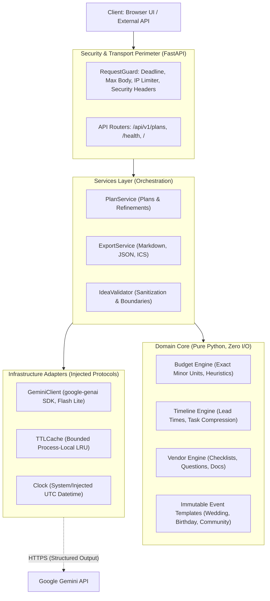
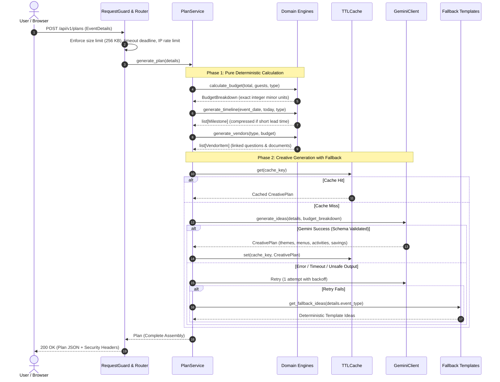

# Gatherly AI Architecture

Gatherly AI is a hybrid deterministic and generative AI celebration and event planner built for Google Virtual PromptWars Challenge 5.

It plans **weddings, birthdays, and community events** with mathematical rigor: money, timelines, and vendor requirements are handled deterministically, while Google Gemini provides personalized creative ideas and refinement under strict schema constraints.

---

## 1. System Overview & Core Principles

### Core Architectural Rules
1. **Purity of Domain:** The `domain/` package contains zero I/O, no network calls, and no system clock reads. All calculations are pure deterministic functions over immutable Pydantic v2 data models.
2. **Deterministic Money & Dates:** Money is strictly computed as integer minor units (`BigInt` in the frontend, Python `int` in the backend). Dates are relative to a caller-injected reference date. LLMs are never allowed to invent or alter financial totals.
3. **Injected Dependencies:** Infrastructure adapters (`GeminiClient`, `TTLCache`, `Clock`) implement service-defined protocols (`IdeasGenerator`, `IdeasCache`, `Clock`). Services never instantiate adapters directly.
4. **Structured Creative Output:** Gemini is invoked only through schema-constrained JSON using Pydantic models. Output is validated, sanitized, and bounds-checked before use.
5. **Deterministic Fallback:** If Gemini fails, times out, or returns unsafe output, the application instantly falls back to curated deterministic templates without failing user requests.
6. **Ephemeral Client State:** The server is entirely stateless; no database, user accounts, or persistent personal data exists. Client plans live in browser memory and persist via lossless JSON export/import.

---

## 2. Request Flow: Plan Generation

---

## 3. Layer Breakdown

### A. Domain Core (`src/gatherly/domain/`)
- **`models.py`:** Strict Pydantic v2 models (`ConfigDict(strict=True, frozen=True)`). Custom annotated types reject string injection, out-of-range guest counts, negative currency, and future limits.
- **`budget.py`:** Allocates integer pennies/cents using Largest Remainder Method (Hamilton-Hare) to guarantee mathematical conservation ($\sum \text{categories} = \text{total}$). Implements dynamic food allocation adjustments based on guest count and minimum per-person thresholds.
- **`timeline.py`:** Computes milestone target dates backwards from event date using reference lead times (Weddings: ~12 months, Birthdays: ~6 weeks, Community: ~12 weeks). For short-notice events, past milestones are labeled `status="due_now"`, and remaining milestones compress chronologically.
- **`vendors.py`:** Produces vendor checklists linked to budget categories with interview questions, document requirements, and booking urgency guidance.
- **`templates/events.py`:** Immutable industry-standard baselines for Wedding, Birthday, and Community events.

### B. Services (`src/gatherly/services/`)
- **`plan_service.py`:** Coordinates deterministic engines and creative generation. Manages the creative cache, request timeouts, and error recovery.
- **`idea_validation.py`:** Revalidates and sanitizes LLM-generated creative content, stripping script tags, neutralizing HTML markup, and enforcing string length limits.
- **`export_service.py`:** Exports the plan into three formats:
  - **JSON:** Lossless round-trip format preserving checklist completion and vendor status.
  - **Markdown:** Structured human-readable summary with task completion checkmarks (`- [x]`).
  - **iCalendar (`.ics`):** Standard RFC 5545 format with all-day milestone events and UID-stamped alarms.
- **`ports.py`:** Abstract Python `Protocol` classes defining boundaries for `IdeasGenerator`, `IdeasCache`, and `Clock`.

### C. Infrastructure (`src/gatherly/infra/`)
- **`gemini_client.py`:** Implements `IdeasGenerator` using the official `google-genai` SDK (`gemini-3.5-flash-lite`). Configures JSON output schema (`response_schema=CreativePlan`), system instructions, thinking level controls, and strict safety thresholds.
- **`cache.py`:** Thread-safe, bounded, in-memory TTL/LRU cache.
- **`clock.py`:** Encapsulates system clock to permit deterministic time traveling in tests.
- **`prompts.py`:** Loads versioned prompts from `prompts/` directory.

### D. Security & HTTP Perimeter (`src/gatherly/api/`)
- **`middleware.py` (`RequestGuard`):** Enforces:
  - Streaming request body length limits (256 KB max).
  - Overall request deadlines (14s max).
  - IP-based fixed-window rate limiting (60 requests/minute) with salted SHA-256 IP hashing.
  - Comprehensive security headers: `Content-Security-Policy`, `X-Content-Type-Options: nosniff`, `X-Frame-Options: DENY`, `Referrer-Policy: strict-origin-when-cross-origin`, and conditional `Strict-Transport-Security`.
- **`routes.py`:** REST API endpoints:
  - `POST /api/v1/plans`: Generate full plan.
  - `POST /api/v1/plans/recalculate-budget`: Purely deterministic budget recalculation slider (zero LLM calls).
  - `POST /api/v1/plans/refine`: Targeted creative refinement for specific plan sections.
  - `POST /api/v1/plans/export/{format}`: File download endpoints for markdown, json, and ics.
- **`errors.py`:** Structured error envelope hiding internal stack traces and sanitizing untrusted inputs.

### E. Frontend (`src/gatherly/web/`)
- **Zero Build Step:** Native HTML5, modern CSS variables, and native ES modules (`app.js`, `model.js`, `render.js`).
- **XSS Immunity:** Model and user text are inserted strictly via `Node.textContent`. InnerHTML is never populated with dynamic strings.
- **Accessibility by Design:** Full keyboard accessibility (roving focus tabstrip, visible focus rings, native checkboxes), high contrast colors, reduced-motion queries, and responsive layouts down to 320px.

---

## 4. Failure Modes & Resilience Matrix

| Component | Failure Mode | Mitigation & Behavior |
|---|---|---|
| **Gemini API** | Network timeout / 5xx / 429 | Request timeout of 6s per attempt, 1 automatic retry, then falls back to deterministic template ideas. Plan generation never fails due to LLM errors. |
| **Gemini API** | Malformed JSON / Schema violation | `google-genai` native JSON schema enforcement; Pydantic revalidation catches anomalies; fallback triggered if invalid. |
| **User Input** | Malicious prompt injection in text fields | User text is encapsulated as data in delimited prompt blocks; LLM is instructed to treat user text strictly as creative preferences; output is schema-constrained and sanitized. |
| **Network** | Slowloris / Large request flood | Streaming chunk counter terminates connections exceeding 256 KB; 14-second request deadline kills hanging sockets. |
| **Client** | Browser reload without export | Warning notice in UI; lossless JSON export and re-import allow user to save and resume planning offline. |
