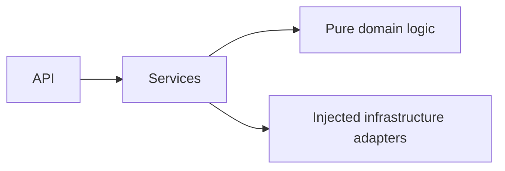

# Gatherly AI

Turn a few event details into a realistic celebration plan, with deterministic
budgets, timelines and checklists plus creative ideas from Gemini.

**Phase 4 hardening implemented.** CI and coverage badges will be linked when the
GitHub repository exists. A screenshot will be added after the Phase 5 frontend.
The source of truth is [the PRD](docs/PRD.md).

## Chosen Vertical

Celebration & Event Planning: weddings, birthdays and community events.

## Approach and Logic

Deterministic code handles money, dates and checklists. Gemini provides
schema-constrained creative ideas and refinement, with deterministic fallback.



The deterministic engines and service orchestration are implemented, including
Gemini integration and fallback. Versioned planning endpoints and exports are available.

## How the Solution Works

The application factory loads validated settings and owns the service's lifetime.
`GET /health` returns `{"status":"ok","version":"0.1.0"}` without network I/O.
The package version is also used in development OpenAPI documentation.
API docs are disabled by default. In development, `/docs` provides Swagger UI,
`/openapi.json` provides the schema, and `/redoc` redirects to `/docs`.
Pure Python domain functions generate budgets, chronological milestones with
phase labels, and vendor checklists. See the [domain example and policies](docs/PHASE_1.md).
The injected plan service combines those components with validated creative ideas,
retries one failed model call, and falls back to templates. See the
[service example and integration decisions](docs/PHASE_2.md).

The API exposes event-type defaults, full plans, budget recalculation, creative
refresh, refinement, and Markdown/JSON/calendar downloads. See the
[API contract and examples](docs/API.md) and [Phase 3 decisions](docs/PHASE_3.md).

## Assumptions

- Python 3.12 and Git are installed; GNU Make is available on PATH.
- The server is stateless; no database, accounts or stored personal data.
- The service works without a Gemini key, using deterministic template ideas.
- Central settings live in `config.py`, matching PRD section 11. Domain packages
  remain free of I/O. Services receive the LLM, cache and clock as dependencies.
- See [Phase 0 verification notes](docs/PHASE_0.md) for submission-rule uncertainty.
- Money is integer minor units in INR, USD, EUR, GBP or JPY. Numerical heuristics,
  bounds and timeline interpretation are documented in [Phase 1](docs/PHASE_1.md).

## Features mapped to the problem statement

Budgets use exact integer allocation, guest-aware food shares and contingency.
Timelines compress when lead time is short and mark missed deadlines due now.
Vendor checklists link allocations to questions, documents and booking guidance.
All three event types are covered. Gemini provides three themes, menus, activities,
personal touches and saving tips tied to actual budget categories.
Plans export as readable Markdown, lossless JSON, or all-day milestone calendars.

## Security

No secrets are required or committed. `.env` is ignored; only `.env.example` is
tracked. Settings use a strict environment whitelist and reject unknown dotenv
keys. Error messages hide input values. Development access logging is disabled
to avoid recording URL query text. `make check` runs Bandit, pip-audit and
gitleaks. Free text is delimited and escaped in prompts; generated text is strictly
validated and sanitised before caching or returning it. The API enforces bounded
bodies, request deadlines, per-IP limits, explicit CORS origins, safe error
envelopes and security headers. See [the current threat model](SECURITY.md).

## Efficiency

The health endpoint and domain engines have no external calls. One structured
model call generates ideas, with at most one retry. Timeouts, a concurrency cap,
an output token ceiling and a bounded TTL/LRU cache control resource use.
Budget recalculation and exports never call AI. Responses support gzip;
explicit creative refresh bypasses the existing ideas cache.

## Testing

Run `make check` for lint, formatting, strict types, tests and scans. Tests enforce
90% overall coverage and 100% domain statement/branch coverage. Hypothesis checks
budget and timeline invariants. See [the test strategy](tests/README.md).
CI runs the same command on pushes and pull requests; advisories require network.
It also builds and verifies the non-root, read-only container with concurrent
offline HTTP requests. See [Phase 4 evidence](docs/PHASE_4.md).

## Accessibility

The frontend and accessibility checks are scheduled for Phase 5. No accessibility
conformance claim is made for this backend foundation.

## Quick start

Install Python **3.12**, Git, GNU Make and
[gitleaks **8.30.1**](https://github.com/gitleaks/gitleaks/releases/tag/v8.30.1).
Put `gitleaks` on PATH (Windows also supports `.tools/gitleaks/gitleaks.exe`).
All Python dependencies are isolated in `.venv`.

```sh
make install
make check
make run
```

On Windows use PowerShell with these same commands (`make install` uses
`py -3.12`). On Unix it uses `python3.12`. Override `PYTHON` when necessary:
`make install PYTHON=/path/to/python3.12`.

Open [the health endpoint](http://127.0.0.1:8000/health).
Copy `.env.example` to `.env` only if local overrides are needed. To enable
documentation, set `GATHERLY_ENVIRONMENT=development` in that file and restart.
The only supported values are `development` and `production` (the default).
Explicit factory settings override environment variables, which override `.env`.

For creative generation, configure `GEMINI_API_KEY` locally. The default
`GEMINI_MODEL` is `gemini-3.5-flash-lite`. No key means fallback mode. The service
defaults to a six-second timeout per attempt, four concurrent calls, and a cache
of 128 successful idea sets lasting 300 seconds. `.env.example` lists the setting
names; [Phase 2 notes](docs/PHASE_2.md) describe limits and the opt-in live test.

HTTP defaults are a 256 KiB body limit, 14-second deadline and 60 API requests per
minute per client address. Cross-origin access requires an explicit allowlist;
same-origin access works by default. See [HTTP settings](docs/API.md#settings).
`make run` and the container ignore forwarded headers. Cloud Run uses an explicit
HTTPS setting; rate limits behind its proxy share the immediate peer's bucket.

For Docker, install a Linux engine and run `make container-test`. To deploy to
Cloud Run, follow the [preview/deploy command and prerequisites](docs/DEPLOYMENT.md).
Deployment defaults to private invocation, one instance and fallback mode.
`PORT` configures the container listener; `GATHERLY_EXTERNAL_HTTPS` is enabled
only behind managed HTTPS ingress. Never enable it for plain local HTTP.

## Project structure

```text
docs/PRD.md          source of truth
docs/PHASE_0.md      foundation decisions and verification sources
src/gatherly/
  main.py           application factory
  config.py         environment and dotenv settings
  api/              routers, schemas, errors, request guards and development docs
  services/         plan orchestration, validation, protocols and text exports
  domain/           models, budget, timeline, vendors and immutable templates
  infra/            Gemini, clock, prompts, cache, rate limiter and composition
prompts/            packaged, versioned system and refinement policies
scripts/            Cloud Run deployment, local load and container verification
tests/
  api/              planning contracts, exports, health and OpenAPI tests
  unit/             settings, domain, template and architecture tests
  property/         generated budget and timeline invariants
  security/         injection, HTTP protections and plan import consistency
  live/             optional Gemini smoke test, disabled in CI
```

The Dockerfile and Cloud Run script are implemented. The frontend remains Phase 5.

## Development commands

- `make install`: create `.venv`, install locked dependencies and editable app,
  then install pre-commit hooks.
- `make lint`: Ruff lint and format verification.
- `make typecheck`: strict mypy on source, scripts and tests.
- `make test`: pytest with the 90% overall and 100% domain coverage gates.
- `make check`: all checks, including static, dependency and Git secret scans.
- `make run`: serve on `127.0.0.1:8000` without access logging or proxy-header trust.
- `make image`: build the pinned runtime image (requires Docker).
- `make container-test`: build and verify non-root/read-only operation and HTTP load.
- `make load`: check the local development budget endpoint with synthetic requests.

Stage intended changes before `make check` so the secret scanner includes new
files. The pre-commit hook checks staged content; CI also scans Git history.
Pre-commit uses pinned Ruff and the same gitleaks lookup as the Makefile.

Direct dependency versions live in `pyproject.toml`. `requirements.txt` is the
checked-in dependency lock manifest, including transitive and build dependencies.
After intentionally updating pins, resolve in a clean Python 3.12 virtualenv,
install `.[dev]`, freeze third-party packages (exclude `gatherly-ai`), and re-run
all checks on the new lock. Never commit virtualenvs, binaries or test reports.

## Limitations and future work

The API accepts explicit affected sections and an integer budget override for
refinement; money is never inferred by the model. Rate counters and caches are
process-local; deployments with multiple workers need perimeter controls.
The frontend remains Phase 5 and starts only after approval.
Live model quality and latency need a configured key; hosted CI and repository
visibility need a GitHub remote.
