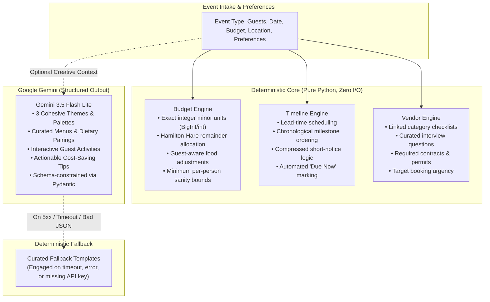

# Gatherly AI

[](.github/workflows/ci.yml)
[](tests/README.md)
[](tests/README.md)
[](pyproject.toml)
[](LICENSE)
[-success.svg)](docs/ACCESSIBILITY.md)
[](docs/ACCESSIBILITY.md)

Turn a few event details into a realistic celebration plan, with deterministic budgets, timelines and checklists plus creative ideas from Gemini.

Built for **Google Virtual PromptWars Challenge 5**.

---

```
  ┌────────────────────────────────────────────────────────────────────────┐
  │                           GATHERLY AI PLANNER                          │
  ├──────────────────────────────────┬─────────────────────────────────────┤
  │ INTAKE & PREFERENCES             │ RESULTS: 120 GUESTS • £25,000.00    │
  │ • Event: Wedding                 │ [Overview] [Budget] [Timeline] ...  │
  │ • Guests: 120                    │                                     │
  │ • Date: 2027-06-15               │ Planned Spending: £25,000.00 (100%) │
  │ • Budget: £25,000.00             │ Contingency:      £2,500.00 (10%)   │
  │ • Location: London, UK           │                                     │
  │ • Theme: Rustic Botanical        │ [x] Book ceremony & venue (Due now) │
  │                                  │ [ ] Caterer tasting (Due in 30d)    │
  │ [Generate celebration plan]      │                                     │
  │ [Reopen JSON plan]               │ What-if slider: [ £20,000 ] [Update]│
  │                                  │ Export: [Markdown] [Calendar] [JSON]│
  └──────────────────────────────────┴─────────────────────────────────────┘
```

See [DEMO_SCRIPT.md](docs/DEMO_SCRIPT.md) for a complete 3-minute interactive walkthrough and [docs/PRD.md](docs/PRD.md) for the source specification.

---

## Chosen Vertical

**Celebration & Event Planning:** Comprehensive planning for **Weddings**, milestone **Birthdays**, and **Community Festivals/Events**.

---

## Approach and Logic

Gatherly AI strictly bifurcates deterministic mathematical responsibilities from generative creative exploration. Gemini is never asked to calculate money or deadlines; deterministic engines never generate creative themes.



---

## How the Solution Works

### Architecture & Layering
1. **Domain Core (`src/gatherly/domain/`):** Pure Python models and logic without external dependencies or I/O.
2. **Services (`src/gatherly/services/`):** Orchestrates domain calculations, export generation, and calls to infrastructure ports.
3. **Infrastructure (`src/gatherly/infra/`):** Concrete implementations of injected protocols for Gemini, system clock, and thread-safe bounded TTL cache.
4. **Perimeter & API (`src/gatherly/api/`):** Streaming body limits (256 KB), strict 14-second request deadlines, per-IP rate limiting, and security headers.
5. **Frontend (`src/gatherly/web/`):** Pure vanilla HTML5, CSS3, and ES modules with **zero runtime npm dependencies** and strict DOM text insertion (`textContent`) to eliminate XSS.

### Primary API Endpoints
| Endpoint | Method | Purpose | Generative AI Used? |
|---|---|---|---|
| `/health` | `GET` | Health check with version & status | No (Deterministic) |
| `/api/v1/plans` | `POST` | Generates full plan (Budget, Timeline, Vendors, Ideas) | Yes (with deterministic fallback) |
| `/api/v1/plans/recalculate-budget` | `POST` | Instant slider recalculation for what-if scenarios | No (Purely deterministic) |
| `/api/v1/plans/refine` | `POST` | Targeted refinement for specific sections | Yes (Section-scoped) |
| `/api/v1/plans/export/{format}` | `POST` | Lossless JSON, structured Markdown, or `.ics` calendar | No (Purely deterministic) |

### Concrete Request & Response Example

#### Request: `POST /api/v1/plans`
```json
{
  "event_type": "birthday",
  "name": "Maya's 30th Birthday",
  "guest_count": 45,
  "event_date": "2027-04-18",
  "location": "Edinburgh, UK",
  "currency": "GBP",
  "total_budget": 350000,
  "preferences": {
    "theme_preference": "Botanical garden party",
    "dietary_restrictions": ["Vegetarian options"],
    "vibe": "Warm and relaxed acoustic",
    "accessibility_notes": "Step-free venue access required"
  }
}
```

#### Response: `200 OK` (Abbreviated excerpt)
```json
{
  "id": "plan_91c7f53a4e",
  "event_details": {
    "event_type": "birthday",
    "name": "Maya's 30th Birthday",
    "guest_count": 45,
    "event_date": "2027-04-18",
    "currency": "GBP",
    "total_budget": 350000
  },
  "budget": {
    "currency": "GBP",
    "total_budget": 350000,
    "allocated_total": 350000,
    "categories": [
      {
        "category": "Food and drinks",
        "allocated_amount": 140000,
        "percentage": 40.0,
        "notes": "Food and beverage service for 45 guests."
      },
      {
        "category": "Venue and equipment",
        "allocated_amount": 87500,
        "percentage": 25.0,
        "notes": "Private room or event space rental."
      },
      {
        "category": "Contingency buffer",
        "allocated_amount": 35000,
        "percentage": 10.0,
        "notes": "Reserve for unexpected expenses."
      }
    ]
  },
  "timeline": [
    {
      "id": "book_venue",
      "title": "Book venue or reserve space",
      "due_date": "2027-03-07",
      "phase": "Bookings",
      "priority": 1,
      "status": "upcoming",
      "completed": false
    }
  ],
  "creative": {
    "themes": [
      {
        "name": "Highland Botanical Garden",
        "description": "Lush greenery, seasonal blooms, and acoustic ambience.",
        "color_palette": ["Forest Green", "Heather Purple", "Warm Gold"]
      }
    ],
    "fallback_used": false
  }
}
```

---

## Assumptions

As defined in PRD Section 14:
1. **One Event per Session:** Users plan a single event at a time; state is held locally in the client session or exported to file.
2. **Deterministic Financial Bounds:** Budgets are expressed as integer minor units in five supported currencies (`INR`, `USD`, `EUR`, `GBP`, `JPY`). Currency is used for exact decimal formatting without cross-currency exchange rates.
3. **Template Baselines:** Baseline allocation percentages and timeline milestones represent standard event management industry practices, adapted automatically when timelines are compressed.
4. **Advisory Scope:** Gatherly provides planning guidance and vendor checklists; it does not constitute legal, permitting, or contractual advice.
5. **Zero-Config Fallback:** A Gemini API key enables personalized creativity, but the platform operates completely without a key using deterministic templates.

---

## Features mapped to the problem statement

* **Budgets:** Exact integer allocation using the Largest Remainder Method guarantees $\sum \text{categories} = \text{total}$ without pennies lost. Dynamic per-person food allocations and explicit contingency buffers protect against cost overruns.
* **Timelines:** Chronological milestone scheduling derived backwards from the celebration date. For tight deadlines, past milestones automatically flag as `due_now` and remaining milestones compress chronologically.
* **Vendor Checklists:** Complete category checklists equipped with tailored interview questions, required permits, and contract milestones.
* **Personalized Ideas:** Gemini supplies 3 distinct creative themes, seasonal menu pairings with dietary accommodations, memorable entertainment, and actionable budget-saving tips.
* **Interactive What-If Budget Slider:** Planners can slide or type a new budget total and see instant reallocation across all categories with zero LLM latency and zero loss of checked tasks.
* **Universal Portability:** Export plans to structured Markdown (with completion checkboxes), universal `.ics` calendars, or lossless JSON. Reopening a JSON export restores the exact workspace.

---

## Security

* **Threat Model & Boundaries:** Documented in [SECURITY.md](SECURITY.md).
* **Zero Secrets in Code:** No credentials committed. Only `.env.example` is tracked.
* **Prompt Injection Protection:** Untrusted user input is encapsulated inside delimited data blocks in system prompts. Model output is schema-constrained via Pydantic v2 and sanitized before rendering.
* **Perimeter Defense:** Max 256 KB streaming body cap, 14-second overall request deadline, salted SHA-256 IP-based rate limiting (60 requests/minute), and strict CSP.
* **Privacy:** Zero persistent server-side storage, no tracking cookies, and zero user data in server logs.
* **Automated Scanners:** Bandit, pip-audit, npm-audit, and Gitleaks pass cleanly on every build.

---

## Efficiency

* **Zero-I/O Domain:** All domain calculations run in sub-millisecond CPU memory.
* **Bounded Model Interaction:** Exactly one structured model invocation per full plan (max 6s timeout, 1 retry).
* **Caching:** Thread-safe, process-local bounded TTL cache (128 entries, 300s TTL) avoids duplicate model calls for identical requirements.
* **No AI for Budget Slider:** What-if budget recalculation and file exports run 100% deterministically without touching LLM APIs.
* **Minimal Footprint:** Total uncompressed frontend payload is ~52 KB. Docker image runs as a non-root, read-only 240 MB container.

---

## Testing

* **Coverage:** Enforced **98.94% overall statement/branch coverage** against a 90% gate; **100.00% domain coverage** against a strict 100% gate.
* **Property-Based Testing:** `hypothesis` verifies budget conservation, milestone ordering, and timeline boundary properties across thousands of randomized inputs.
* **Browser & Integration Tests:** Playwright tests wedding, birthday, and community flows, keyboard navigation, JSON round-trips, and responsive breakpoints (320px–1440px).
* **Details:** See [tests/README.md](tests/README.md) for test architecture.

---

## Accessibility

* **Target:** Full compliance with **WCAG 2.2 AA**.
* **Automated Audits:** Zero violations reported by `axe-core 4.14.0` across all views, modals, and color schemes.
* **Lighthouse Score:** **Accessibility: 100 / 100**, **Best Practices: 100 / 100**.
* **Keyboard & Screen Reader Support:** Roving focus tab navigation, native input semantics, 44px touch targets, high contrast modes, and reduced motion queries.
* **Details:** See [docs/ACCESSIBILITY.md](docs/ACCESSIBILITY.md).

---

## Quick start

### Local Development

1. **Prerequisites:** Python 3.12, Node 22.19+, GNU Make, Git, and Gitleaks 8.30.1.
2. **Install & Verify:**
   ```sh
   make install
   make check
   ```
3. **Run Server:**
   ```sh
   make run
   ```
   Open **[http://127.0.0.1:8000/](http://127.0.0.1:8000/)** to access the Gatherly AI planner.

### Environment Configuration

Copy `.env.example` to `.env` if local overrides are desired:
```sh
# Optional: supply Gemini API key for live AI ideas (runs in fallback mode without it)
GEMINI_API_KEY=your_gemini_api_key

# Optional settings
GEMINI_MODEL=gemini-3.5-flash-lite
GATHERLY_ENVIRONMENT=production  # Set to 'development' to enable Swagger /docs
```

### Docker Deployment

Build and verify the hardened container locally:
```sh
make image
make container-test
```
Run the container:
```sh
docker run -p 8000:8000 --read-only --cap-drop=ALL gatherly-ai:local
```

### Google Cloud Run Deployment

Deploy directly using the hardened deployment script in [`scripts/deploy.py`](scripts/deploy.py):
```sh
python scripts/deploy.py --project-id <YOUR_GCP_PROJECT> --region us-central1 --service gatherly-ai
```
See [docs/DEPLOYMENT.md](docs/DEPLOYMENT.md) for full Cloud Run configuration, secret binding, and production hardening.

---

## Project structure

```text
gatherly-ai/
├── README.md                           # Master blueprint & quickstart
├── ARCHITECTURE.md                     # Deep architectural specification
├── SECURITY.md                         # Threat model & perimeter controls
├── CONTRIBUTING.md                     # Contributor & engineering standards
├── LICENSE                             # MIT License
├── Makefile                            # Automated build & verification targets
├── Dockerfile                          # Hardened non-root container
├── pyproject.toml                      # Pinned Python package dependencies
├── requirements.txt                    # Fully resolved lockfile
├── package.json                        # Development browser-test tooling
├── package-lock.json                   # Resolved browser-test lockfile
├── playwright.config.mjs               # Playwright browser test configuration
├── .env.example                        # Safe environment variable template
├── .github/workflows/ci.yml            # Automated CI pipeline
├── docs/
│   ├── PRD.md                          # Source of truth specification
│   ├── ACCESSIBILITY.md                # WCAG 2.2 AA audit & verification
│   ├── DEMO_SCRIPT.md                  # 3-minute interactive evaluation guide
│   ├── DEPLOYMENT.md                   # Cloud Run deployment manual
│   ├── API.md                         # Full API OpenAPI reference
│   └── PHASE_*.md                      # Phase audit records (0 through 6)
├── prompts/                            # Versioned system & refinement prompts
├── scripts/                            # Cloud Run deploy, container & load tests
├── src/gatherly/
│   ├── main.py                         # Application factory & ASGI entrypoint
│   ├── config.py                       # Pydantic-settings configuration
│   ├── api/                            # Routers, schemas, middleware, errors
│   ├── services/                       # PlanService & ExportService
│   ├── domain/                         # Pure deterministic models, budget, timeline, vendors
│   ├── infra/                          # Gemini client, TTL cache, Clock
│   └── web/                            # Accessible vanilla HTML/CSS/ES frontend
└── tests/                              # Unit, property, api, security, browser tests
```

---

## Development commands

* `make install`: Create `.venv`, install locked Python & Node dev dependencies, configure pre-commit hooks.
* `make lint`: Run Ruff linter and format verification across all Python code.
* `make typecheck`: Run Mypy strict type checking across all 69+ source files.
* `make test`: Execute pytest with 90% overall and 100% domain coverage enforcement.
* `make web-check`: Run Prettier, Node unit tests, Playwright browser suite, axe-core, and Lighthouse.
* `make scan`: Run Bandit security audit, pip-audit, npm-audit, and Gitleaks secret scan.
* `make check`: Run the complete validation gate (`lint`, `typecheck`, `test`, `scan`, `web-check`).
* `make run`: Launch the local development server at `http://127.0.0.1:8000/`.
* `make image`: Build the hardened Docker container image.
* `make container-test`: Test container startup, non-root execution, and offline load.

---

## Limitations and future work

* **Process-Local Caches:** The rate limiter and TTL cache are held in process memory. Multi-replica Cloud Run deployments benefit from edge rate limiting (e.g., Cloud Armor) and shared Redis if cross-instance caching is desired.
* **Single Event Scope:** Planners organize one celebration at a time. Multi-event dashboards and guest collaboration are candidate stretch features.
* **Additional Event Types:** Planned support for Corporate retreats, conferences, and baby showers using the same deterministic domain pattern.
