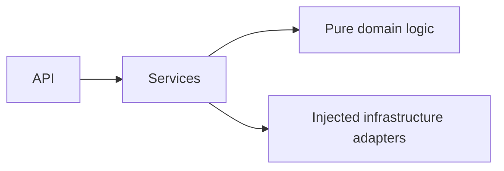

# Gatherly AI

Turn a few event details into a realistic celebration plan, with deterministic
budgets, timelines and checklists plus creative ideas from Gemini.

**Phase 0 foundation only.** CI and coverage badges will be linked when the
GitHub repository exists. A screenshot will be added after the Phase 5 frontend.
The source of truth is [the PRD](docs/PRD.md).

## Chosen Vertical

Celebration & Event Planning: weddings, birthdays and community events.

## Approach and Logic

Deterministic code will handle money, dates and checklists. Gemini will provide
schema-constrained creative ideas and refinement, with deterministic fallback.



These planning components are reserved for later PRD phases.

## How the Solution Works

The application factory loads validated settings and registers a health router.
`GET /health` returns `{"status":"ok","version":"0.1.0"}` without network I/O.
The package version is also used in development OpenAPI documentation.
API docs are disabled by default. No planning endpoints are implemented yet.

## Assumptions

- Python 3.12 and Git are installed; GNU Make is available on PATH.
- The server is stateless; no database, accounts or stored personal data.
- Phase 0 needs no Gemini key. SDK, model selection and fallback arrive in Phase 2.
- Central settings live in `config.py`, matching PRD section 11. Domain packages
  remain free of I/O. Later service adapters will use dependency injection.
- See [Phase 0 verification notes](docs/PHASE_0.md) for submission-rule uncertainty.

## Features mapped to the problem statement

Budgets, timelines and vendor checklists are planned for Phase 1; personalized
ideas for Phase 2. Only liveness and central configuration ship in Phase 0.

## Security

No secrets are required or committed. `.env` is ignored; only `.env.example` is
tracked. Settings use a strict environment whitelist and reject unknown dotenv
keys. Error messages hide input values. Development access logging is disabled
to avoid recording URL query text. `make check` runs Bandit, pip-audit and
gitleaks. The complete threat model and API protections arrive in later phases.

## Efficiency

The health endpoint has no external calls. No frontend, database or AI dependency
is installed in Phase 0. Caching and model-call controls arrive in Phase 2.

## Testing

Run `make check` for lint, formatting, strict types, tests and scans. Tests enforce
90% combined statement/branch coverage. See [the test strategy](tests/README.md).
CI runs the same command on pushes and pull requests; advisories require network.

## Accessibility

The frontend and accessibility checks are scheduled for Phase 5. No accessibility
conformance claim is made for this backend foundation.

## Quick start

Install Python **3.12**, Git, GNU Make and
[gitleaks **8.30.1**](https://github.com/gitleaks/gitleaks/releases/tag/v8.30.1).
Put `gitleaks` on PATH (Windows also supports `.tools/gitleaks/gitleaks.exe`).
All Python dependencies are isolated in `.venv`.

```sh
make install
make check
make run
```

On Windows use PowerShell with these same commands (`make install` uses
`py -3.12`). On Unix it uses `python3.12`. Override `PYTHON` when necessary:
`make install PYTHON=/path/to/python3.12`.

Open [the health endpoint](http://127.0.0.1:8000/health).
Copy `.env.example` to `.env` only if local overrides are needed. To enable
documentation, set `GATHERLY_ENVIRONMENT=development` in that file and restart.
The only supported values are `development` and `production` (the default).
Explicit factory settings override environment variables, which override `.env`.

Docker and Cloud Run instructions will be added in Phase 4.

## Project structure

```text
docs/PRD.md          source of truth
docs/PHASE_0.md      foundation decisions and verification sources
src/gatherly/
  main.py           application factory
  config.py         environment and dotenv settings
  api/              health route and response schema
  services/         empty orchestration package
  domain/           empty pure-logic package
  infra/            empty adapter package
tests/
  api/              health and documentation tests
  unit/             settings tests
```

Prompt files, the frontend, future test suites and deployment files will be
created in their assigned phases.

## Development commands

- `make install`: create `.venv`, install locked dependencies and editable app,
  then install pre-commit hooks.
- `make lint`: Ruff lint and format verification.
- `make typecheck`: strict mypy on source and tests.
- `make test`: pytest with coverage and the 90% gate.
- `make check`: all checks, including static, dependency and Git secret scans.
- `make run`: serve on `127.0.0.1:8000` without access logging.

Stage intended changes before `make check` so the secret scanner includes new
files. The pre-commit hook checks staged content; CI also scans Git history.
Pre-commit uses pinned Ruff and the same gitleaks lookup as the Makefile.

Direct dependency versions live in `pyproject.toml`. `requirements.txt` is the
checked-in dependency lock manifest, including transitive and build dependencies.
After intentionally updating pins, resolve in a clean Python 3.12 virtualenv,
install `.[dev]`, freeze third-party packages (exclude `gatherly-ai`), and re-run
all checks on the new lock. Never commit virtualenvs, binaries or test reports.

## Limitations and future work

This foundation does not produce event plans. Follow PRD section 12 one phase
at a time; Phase 1 starts only after explicit approval. Hosted CI and repository
visibility cannot be verified until a GitHub remote is configured.
